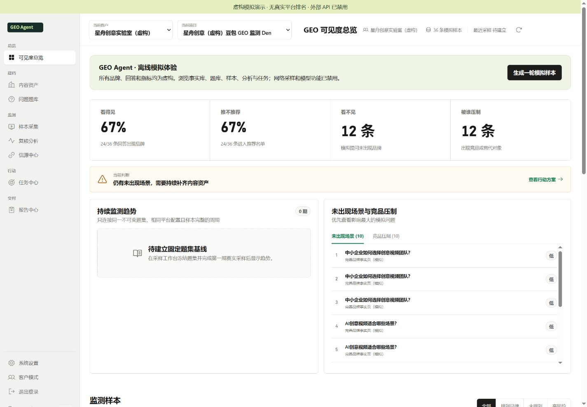
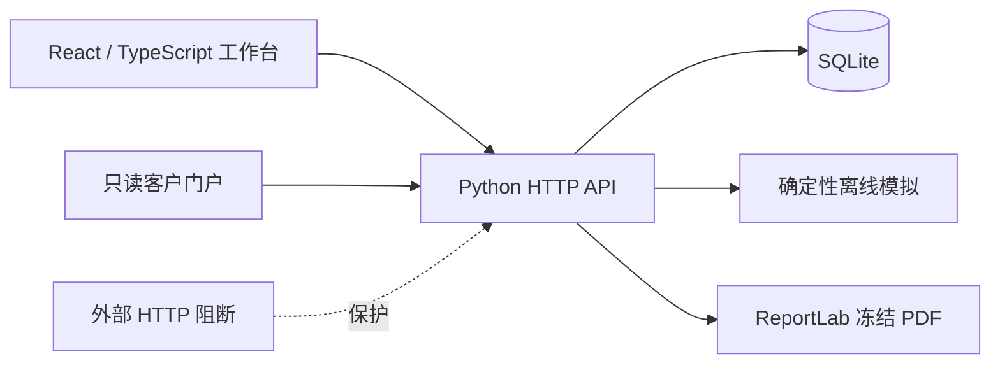

# GEO Agent

**AI 品牌可见度监测与优化工作台**

把「AI 回答有没有提到品牌」变成一条可追踪的工作流：整理品牌事实 → 管理提问题集 → 保存回答 → 复核分析 → 建立优化任务 → 复测 → 冻结报告。

这是面向个人作品集的公开演示版本。所有客户、品牌、回答、竞品和指标均为**虚构模拟**。本地体验不需要 API Key，不会自动采样，也不会调用付费模型。

> GEO 观察的是一组回答中的品牌提及、推荐与事实准确性。API 联网近似采样不等同于产品客户端的搜索排名，也不能保证品牌曝光或推荐结果。此公开版没有真实平台采样数据。



## 可以体验什么

| 工作区 | 体验内容 |
| --- | --- |
| 内容资产 | 虚构品牌事实、服务范围、禁用表述、竞品，以及资料管理 |
| 问题题库 | 提问场景、手工候选题、审核与题集管理 |
| 样本与分析 | 12 道示例问题、虚构回答、品牌出现与推荐标记、规则分析 |
| 任务中心 | 从缺口到内容优化任务的记录与状态管理 |
| 报告中心 | 草稿、人工审核、版本保存与冻结 PDF |
| 客户门户 | 独立登录、只读报告和对应版本 PDF |

点击任意工作区顶部的「**生成一轮模拟样本**」，会在当前项目中添加至多 40 道题的确定性虚构回答与规则分析。初始示例题目为 12 道。模拟样本使用 `sample_type=mock`，不会变成真实监测记录；重复点击会保存新的模拟批次。

四个平台的采样适配代码、固定题集、周期调度、分析复核及复测质量门保留在源码中，用于展示系统结构。**外部 HTTP 请求被强制阻断，自动采样和自动分析循环不启动**。网页抓取、模型生成、联网采样与真实周期趋势不能在此版本中执行，相关入口可能返回演示版限制提示。模拟结果不进入正式真实周期趋势。

## 本地运行

需要 Python 3.12、Node.js 22，以及 pnpm 11。命令在仓库根目录执行；Python 虚拟环境用于隔离依赖。

```bash
python -m venv .venv
# macOS / Linux
source .venv/bin/activate
# Windows PowerShell 使用：.venv\Scripts\Activate.ps1

python -m pip install -r requirements.lock
cd frontend
pnpm install --frozen-lockfile
pnpm build
cd ..
python -m scripts.run_demo
```

访问 [本地工作台](http://127.0.0.1:8765/dashboard.html)。首次启动会根据仓库中的虚构种子文件生成 SQLite 数据库、模拟报告和演示门户账户，数据库与本地配置不会进入 Git。

若尚未安装 pnpm，可以通过 `npm install -g pnpm@11` 安装。构建只允许 `esbuild` 的必要安装脚本，相关配置位于 `frontend/pnpm-workspace.yaml`。

客户门户：[本地报告门户](http://127.0.0.1:8765/portal.html)。演示账户为 `demo-visitor`，密码为 `fictional-demo-only`。这是公开的模拟账户，仅用于此本地虚构数据集。工作台只绑定本机 `127.0.0.1`。

端口可用 `GEO_AGENT_PORT` 调整。Windows PowerShell 例如：

```powershell
$env:GEO_AGENT_PORT="8766"
python -m scripts.run_demo
```

`GEO_AGENT_AUTH_ENABLED=false` 由演示启动器设置，便于本机体验。不要把此演示启动器作为公网部署服务。此仓库不提供公网部署或生产运行承诺。

## 验证

```bash
python -m unittest discover -s tests/characterization -v
cd frontend
pnpm typecheck
pnpm build
```

公开版测试创建临时 SQLite 数据库或从虚构种子生成独立工作区，不依赖任何正式客户数据库。覆盖离线保护、模拟批次关联、凭据配置拒绝、静态文件范围、HTML 缓存、冻结 PDF 哈希、门户登录、报告锁定、调度持久化与执行器状态机。平台调用在保留的执行器测试中使用假的回调。

GitHub Actions 会安装依赖、检查 TypeScript、构建前端并运行此测试集。详细范围见 [测试说明](tests/README.md)。

## 架构



- `frontend/src`：页面、服务接口、报告数据模型与交互。
- `scripts/backend_server.py`：HTTP API、数据迁移、分析复核、任务与报告流程。
- `scripts/offline_demo.py`：不联网的模拟采样与分析。
- `scripts/offline_guard.py`：阻断标准 HTTP 请求及自定义 opener。
- `scripts/demo_report.py`：虚构报告和演示门户账户。
- `scripts/sampling_providers.py`：保留的平台适配器；公开运行流程不会调用真实平台。
- `scripts/sampling_executor.py`、`automation_pipeline.py`：执行器与自动化状态机；演示启动不启用后台循环。
- `schema`：数据库结构参考；启动执行幂等迁移。
- `data`：运行时数据库、配置和报告输出，已忽略。

现有后端集中在一个较大的模块中；这是项目演进中保留的结构。公开版优先确保数据隔离和本地可体验性，后续可以把身份、采样、证据和报告拆成独立服务模块。

## 数据和展示范围

此仓库从当前产品源码整理而来，使用全新 Git 历史。没有复制正式数据库、客户文件、原品牌 Logo、API 凭据、内部部署配置、审计材料或交接记录。Logo 为本仓库新写的文字 SVG。

示例数据来自仓库内的虚构种子文件，名称包含「虚构」，回答包含「虚构模拟」。所有截图来自同一模拟环境。旧正式数据库依赖的内部测试没有随公开版发布；公开版用独立测试与新演示集成测试验证其支持范围，不能把这些结果解释为原内部项目完整测试结果。

## 使用与权利

本项目以公开作品展示形式发布，尚未选定开源许可证。公开可见不代表授予商业使用、修改或再分发的许可。第三方依赖保留各自许可证；本仓库不改变其权利。

作品设计说明见 [设计与边界](docs/design.md)。
